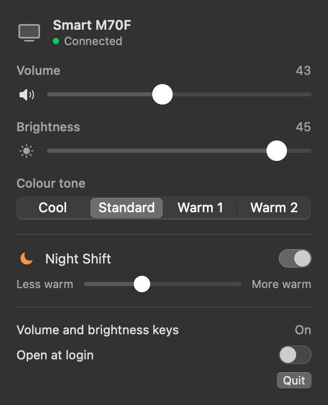

# M7 Control

A macOS menu bar app that controls a Samsung Smart Monitor from the Mac. The keyboard's volume
and brightness keys drive the monitor's real volume and backlight, and a small panel adds colour
tone and Night Shift.



Samsung's smart monitors ignore DDC, the cable-based control that apps like MonitorControl rely
on, so on a Mac the volume and brightness keys do nothing. This app talks to the monitor over the
local network instead, using a control service that is built into the monitor.

## What it does

- **Volume keys** change the monitor's volume (0-100) and mute, while sound is going to the monitor.
  With headphones or the Mac's speakers selected, macOS handles the keys as usual.
- **Brightness keys** change the monitor's hardware backlight (0-50, the monitor's own Brightness
  slider) while the pointer is on the monitor. Shift+Option gives single steps. Apple keyboards
  send these as special-key events; Logitech keyboards send F14/F15, and both are handled.
- **Menu bar panel**: volume, brightness, colour tone (Cool, Standard, Warm 1, Warm 2), Night Shift
  on/off and warmth, open at login.
- A small indicator near the top-right of the monitor shows the new level after each key press.

Everything stays on your local network. There is no cloud account, no SmartThings and no telemetry.

## Compatibility

| Display | Status |
|---|---|
| Smart Monitor M7 43" 2025 (M70F, `LS43FM700UWXXL`, firmware `T-RSLMFWWC-0090-1320.3`) | Tested, on macOS 27 with an M4 Pro MacBook Pro |
| Smart Monitor M7 2024 (M70D), ViewFinity S9 | Others report the same service working; not tested here |
| Other Samsung smart monitors and TVs with an "IP Remote" setting | Unknown. The probe script below will tell you |

To check a display before building anything, switch on IP Remote (see Setup) and run the probe.
It needs only Python 3:

```bash
M7_IP=192.168.1.20 python3 tools/ipcontrol_probe.py pair
M7_IP=192.168.1.20 python3 tools/ipcontrol_probe.py read
M7_IP=192.168.1.20 python3 tools/ipcontrol_probe.py backlight
```

Replace the address with your display's. `backlight` changes the real backlight for four seconds
and restores it. If you pair with the probe, the app picks up that pairing on first launch.

## Setup

Requirements: macOS 14 or later, and Xcode 16 or later (Swift 6 toolchain) to build. There is no
prebuilt download.

1. On the monitor: Settings > Connection > Network > Expert Settings > **IP Remote** on
   (Power On with Mobile must also be on).
2. Build and install:

   ```bash
   ./scripts/build-app.sh --install
   ```

3. Open the panel from the menu bar and choose **Pair with monitor**, then pick Allow on the
   monitor's popup. The Mac's picture has to be showing, not the Samsung home screen.
4. Allow **Accessibility** for M7 Control in System Settings > Privacy & Security, so it can see
   the volume and brightness keys. Allow the Local Network prompt if macOS shows one.

If the keys do nothing after a rebuild, see "Rebuilding resets Accessibility" below.

## How it works

The monitor runs Samsung's "IP Control" service: JSON-RPC over HTTPS on port 1516, switched on by
the IP Remote setting. Samsung documents the commands only for its control-system partners, so the
method names here come from Samsung's public command list and from testing on the monitor above.

| Method | Parameter | Values |
|---|---|---|
| `getTVStates` | | volume, mute, input, picture mode |
| `directVolumeControl` | `volume` | 0-100 |
| `muteControl` | `mute` | `muteOn`, `muteOff` |
| `backlightControl` | `backlight` | 0-50 |
| `colorToneControl` | `colorTone` | `Cool`, `Standard`, `Warm1`, `Warm2` |
| `createAccessToken` | | pairing; needs Allow on the monitor |

Calling a method without its parameter reads the current value. The access token goes inside
`params` as `AccessToken`. A missing or stale token gets a bare `{"code": -32700, "message": "Parse error"}`.

The same service also answered `contrastControl`, `brightnessControl` (shadow detail),
`sharpnessControl`, `colorControl`, `tintControl`, `pictureModeControl`, `soundModeControl`,
`inputSourceControl` and `powerControl` on the tested monitor. The app does not use those yet.

Things worth knowing:

- **One token per monitor.** Pairing another controller replaces this app's token.
- **Certificate pinning.** The monitor's self-signed certificate is recorded at pairing, and the
  token is only ever sent to a device presenting that same certificate.
- **Finding the monitor.** The last address is remembered; if it stops answering, the app looks
  for the monitor again through Bonjour (`_samsungmsf._tcp`).
- **Night Shift** uses `CBBlueLightClient` from Apple's private CoreBrightness framework. It works
  on macOS 27 but Apple could change it in any release. The app would not pass App Store review.
- **Colour tone and Night Shift are different things.** Colour tone is the monitor's own white
  balance and affects everything it shows. Night Shift is macOS warming the picture it sends. They
  stack.
- **Token storage.** The pairing lives in `~/Library/Application Support/M7 Control/pairing.json`,
  readable only by the owner. It is not in the Keychain because the build is ad-hoc signed, and the
  Keychain would ask for the login password after every rebuild.
- **Rebuilding resets Accessibility.** macOS ties that permission to the exact build of an ad-hoc
  signed app. After a rebuild, clear the stale approval and reopen the app, then allow it again:

  ```bash
  tccutil reset Accessibility com.metroglitch.m7control; pkill -x M7Control; sleep 2; open "/Applications/M7 Control.app"
  ```

  Signing with your own Developer ID (edit the `codesign` line in `scripts/build-app.sh`) avoids this.

## Development

```bash
swift test                                   # unit tests for request, reply and key decoding
swift build && .build/debug/M7Control --status   # what the app sees, no window needed
.build/debug/M7Control --nudge               # moves volume and brightness one step and back
.build/debug/M7Control --snapshot panel.png  # renders the panel with live values to an image
```

Layout:

- `Sources/M7Core`: pure logic (JSON-RPC bodies, reply parsing, media key decoding).
- `Sources/NightShiftBridge`: Objective-C shim over the private Night Shift client.
- `Sources/M7Control`: the app (monitor client, key listener, indicator, panel).
- `tools/ipcontrol_probe.py`: standalone compatibility probe.

Not included yet: input switching, power, contrast and picture mode.

## Credits

- Samsung's public [IP command list](https://image-us.samsung.com/SamsungUS/samsungbusiness/resources/pdfs/ip-command-list/IP-Command-List_2023.pdf),
  which names the controls this service offers.
- The write-up in [BetterDisplay issue 5861](https://github.com/waydabber/BetterDisplay/issues/5861),
  which documented the request format and pairing on an M70D.
- [Samsung-Dumb-Monitor](https://github.com/flyBacon/Samsung-Dumb-Monitor), a similar app for the
  ViewFinity S9.

No code from those projects is used here.

## Disclaimer

This is an independent project. It is not affiliated with or endorsed by Samsung or Apple. It uses
an interface Samsung does not document for the public and a private macOS framework, so a firmware
or macOS update can break it. Use it at your own risk.

## Licence

[MIT](LICENSE)
